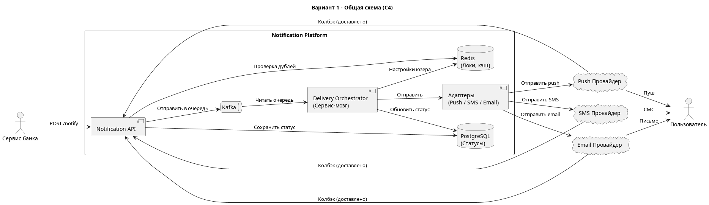
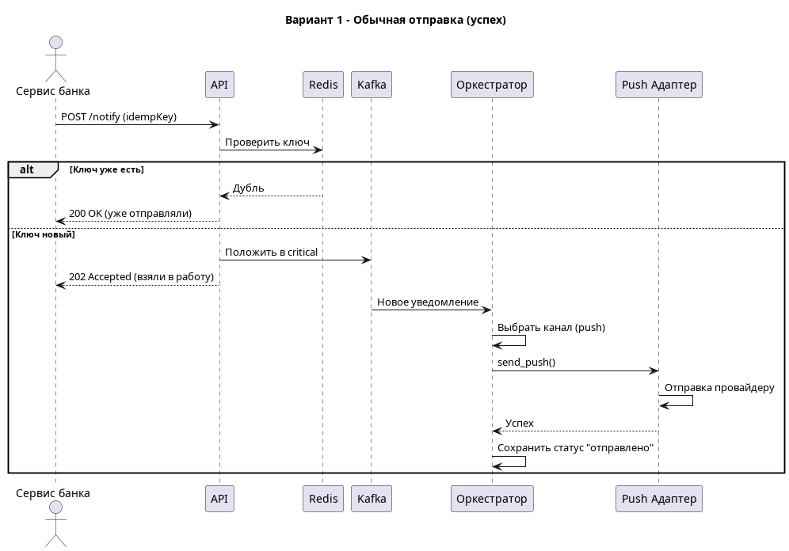
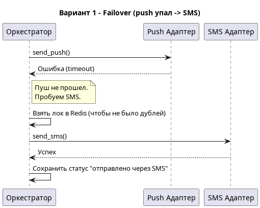
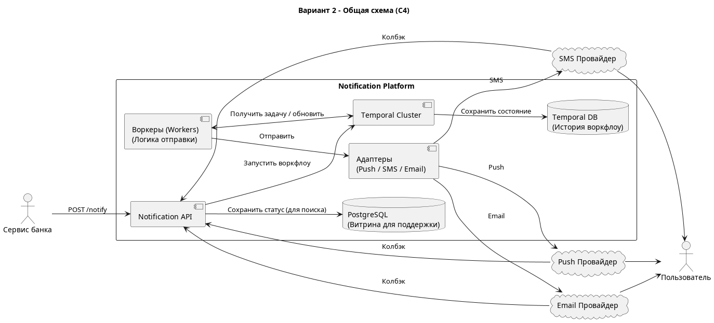
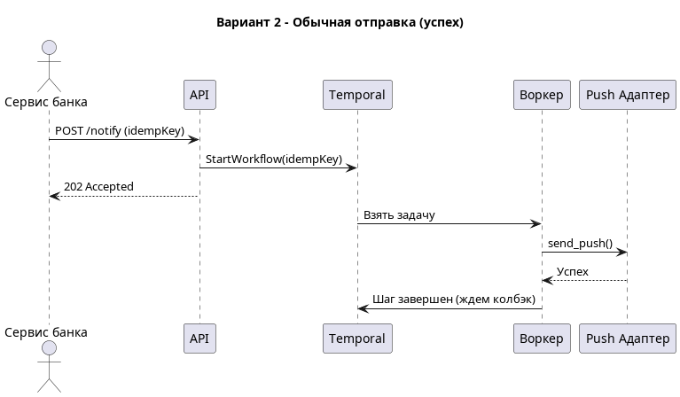
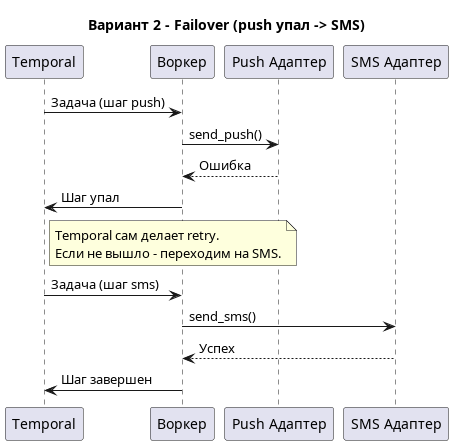

# RFC: Гарантированная доставка критичных уведомлений с failover между каналами

## 1. Контекст

Сейчас в банке каждая команда делает уведомления сама. Из-за этого бывают задержки, дубли и нет гарантии, что критичное сообщение (например, подтверждение перевода) дойдёт до пользователя. 

Мы делаем единую платформу. В этом RFC проектируем самую важную часть: **доставку критичных уведомлений** с автоматическим переключением каналов (push -> SMS -> email).

**Главная боль:** SMS стоит денег (~3 рубля за штуку), а push и email — бесплатно. Поэтому SMS используем только как резерв, а не шлём всё подряд.

**Что должна уметь система:**
- Доставлять критичное уведомление хотя бы одним каналом.
- Если push не дошёл — автоматически шлём SMS.
- Не отправлять одно и то же дважды.
- Уважать настройки пользователя (но транзакционные уведомления отключить нельзя, это безопасность).

---

## 2. Статистика и нагрузка

У нас 3 млн активных пользователей в день (DAU). В день на юзера приходится примерно 10 уведомлений (2 транзакционных, 3 сервисных, 5 маркетинговых).

**Считаем нагрузку:**
- Всего в день: 3 млн * 10 = 30 млн уведомлений. Это ~350 в секунду в среднем.
- Транзакционных: 3 млн * 2 = 6 млн в день. Это ~70 в секунду, но в пике (вечером, в день зарплат) может быть 400–500 в секунду.
- Маркетинговая кампания: до 1 млн получателей. Если запустить разом — система ляжет. Значит, нужно растягивать отправку во времени (throttling).
- **SMS-бюджет:** если в SMS будет уходить 20% от транзакционных, это 1.2 млн SMS в день. По 3 рубля = 3.6 млн рублей в день. Дорого! Поэтому цель — чтобы в SMS уходило не больше 5–10%.

**Вывод:** система должна выдерживать пики до ~1000 уведомлений в секунду, а маркетинг не должен мешать транзакциям.

---

## 3. Требования

### Функциональные (FR)
| № | Приоритет | Описание |
|---|---|---|
| FR1 | MUST | Принимать запрос на отправку и быстро отдавать ID уведомления (чтобы сервис банка не ждал). |
| FR2 | MUST | Поддерживать 3 канала: push, SMS, email. |
| FR3 | MUST | Выбирать канал с учётом настроек юзера и наличия контактов. |
| FR4 | MUST | Если канал упал — автоматически переключаться на следующий (push -> SMS -> email). |
| FR5 | MUST | Не дублировать уведомления (если push всё-таки дошёл, SMS слать не надо). |
| FR6 | MUST | Сохранять историю: куда отправили, когда, какой результат. |
| FR7 | SHOULD | Обрабатывать колбэки от провайдеров (что уведомление реально доставлено). |

### Нефункциональные (NFR)
| № | Приоритет | Описание |
|---|---|---|
| NFR1 | MUST | 95% критичных уведомлений должны уходить в канал за 2 секунды. |
| NFR2 | MUST | 99.5% уведомлений доставлены хотя бы одним каналом за 5 минут. |
| NFR3 | MUST | Доступность критичного пути — 99.95%. |
| NFR4 | MUST | Если один провайдер упал — система продолжает работать. |
| NFR5 | MUST | По любому ID уведомления поддержка должна видеть статус за 1 минуту. |
| NFR6 | SHOULD | Доля SMS среди успешных доставок — не более 20%. |

### ASR (Архитектурно значимые)
1. **Мгновенная доставка (P0):** p95 <= 2 сек. Влияет на то, что критичные уведомления должны идти по отдельному быстрому пути, без очередей.
2. **Гарантия доставки + защита от дублей (P0):** нужна память о состоянии каждого уведомления и идемпотентность.
3. **Масштаб (P1):** пики до 500/сек и кампании на 1 млн. Нужна изоляция потоков.
4. **Наблюдаемость (P1):** сквозной ID и логи, чтобы можно было разобраться, почему не пришло.

---

## 4. Варианты решения

### Вариант 1: Kafka + свой сервис-оркестратор + PostgreSQL

**Как работает:**
API принимает запрос, кидает его в Kafka. Отдельный сервис (Оркестратор) читает из Kafka, смотрит настройки в Redis, вызывает провайдера (push/SMS/email), сохраняет статус в PostgreSQL. Если провайдер упал — Оркестратор сам решает переключиться на другой канал.

**Диаграммы:**

**Технологии:**
- API: Go.
- Очередь: Kafka (топики `critical` и `bulk` отдельно, чтобы маркетинг не мешал).
- База: PostgreSQL (храним статусы и историю).
- Кэш и локи: Redis (проверка дублей и быстрые настройки).
- Провайдеры: отдельные адаптеры на Go.

**Плюсы:**
- Полный контроль над логикой. Можно гибко настроить ретраи.
- Kafka и PostgreSQL скорее всего уже есть в банке.
- Стек знакомый, команда быстро сделает.

**Минусы:**
- Логику переключений (state machine) пишем сами — можно наделать багов.
- Нужно аккуратно писать локи в Redis, чтобы не было дублей.

---

### Вариант 2: Temporal (готовый движок воркфлоу)

**Как работает:**
Вместо того чтобы писать логику переключений руками, мы берем Temporal. Каждое уведомление — это «воркфлоу» внутри Temporal. Он сам делает ретраи, сам запоминает состояние и переключает шаги. API просто запускает воркфлоу.

**Диаграммы:**

**Технологии:**
- API: Go.
- Движок: Temporal Cluster (он сам хранит состояние воркфлоу).
- База: PostgreSQL (только для витрины поддержки, чтобы быстро искать статусы).
- Провайдеры: те же адаптеры (в Temporal они называются activities).

**Плюсы:**
- Не надо писать свой state machine — Temporal всё делает из коробки.
- В Temporal есть свой UI, где видно каждый шаг уведомления (удобно для поддержки).
- Очень надёжно (durable state).

**Минусы:**
- Temporal — это новая технология. Надо её разворачивать и учить команду.
- Привязка к Temporal (если захотим уйти — будет больно).
- Для простых задач может показаться избыточным.

---

## 5. Сравнение и вывод

| Критерий | Вариант 1 (Kafka) | Вариант 2 (Temporal) |
|---|---|---|
| Скорость разработки | ~4 месяца | ~3.5 месяца |
| Сложность кода | Высокая (пишем логику сами) | Низкая (Temporal делает) |
| Инфраструктура | Знакомая (Kafka, PG) | Новая (кластер Temporal) |
| Наблюдаемость | Свои дашборды (Jaeger) | Есть готовый UI |

**Что выбираем: Вариант 1 (Kafka + Оркестратор).**

**Почему:**
1. Kafka почти наверняка уже есть в банке — не надо поднимать новые кластеры.
2. Ребятам проще — все знают Kafka и PostgreSQL, а Temporal пришлось бы учить с нуля.
3. Нам нужен тонкий контроль над ретраями и логами, свой оркестратор даёт больше гибкости.
4. Temporal — круто, но это оверинжиниринг для первого запуска. Если упрёмся в ограничения — потом переедем.

**Риски:**
- Если провайдеры (SMS, email, push) лягут одновременно — мы ничего не сделаем. Это решается только договорами с провайдерами.
- Гарантировать «пользователь прочитал» нельзя. Гарантируем только «провайдер принял и доставил».